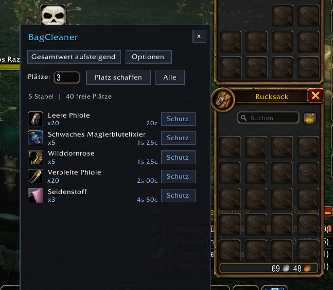
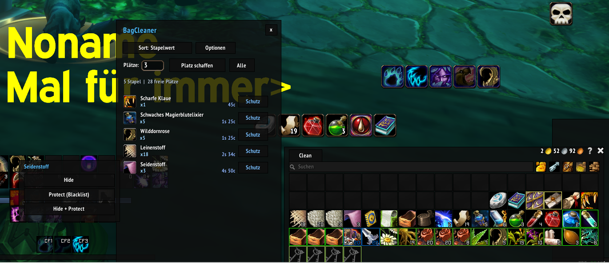

# BackCleaner

BackCleaner is the source repository for **BagCleaner**, a World of Warcraft bag-cleaning addon for **WoW Forever only** (TOC interface `16001`). BagCleaner scans eligible low-value items, shows them in a dedicated clean-up list, and lets the player free bag slots with explicit in-game clicks.

The repository is named `BackCleaner`; the installed addon must remain named `BagCleaner`.

## Highlights

- Finds sellable grey and white bag items and orders complete stacks by **total vendor value**, cheapest first.
- Can select a remembered number of stacks or every eligible stack, while retaining a confirmation prompt by default.
- Uses a click-gated deletion queue: WoW Forever requires a real click for every stack deleted.
- Excludes hearthstones, conjured items detected through tooltip data, items with no positive vendor value, quest items, hidden item types, and protected items.
- Provides per-item deletion, Hide, Protect (blacklist), and Hide + Protect controls.
- Works as a standalone addon, adds launchers to detected ElvUI bag frames, and exposes a Titan Panel / LibDataBroker entry when available.
- Includes a minimap launcher and a small standalone launcher for the default bag UI.

## Screenshots

Standalone bag integration:



ElvUI bag integration:



These are repository documentation images; they are not addon runtime assets.

## Compatibility and dependencies

| Item | Status |
| --- | --- |
| WoW client | WoW Forever only, interface `16001` (the addon source identifies this as client 1.60.1) |
| Other WoW clients | Not supported or verified, including the 3.3.5a client |
| Required dependencies | None |
| ElvUI | Optional; BagCleaner detects supported bag-frame candidates and prefers this integration |
| Titan Panel | Optional; uses LibDataBroker when available, otherwise attempts Titan's native registration |

The TOC lists `ElvUI`, `Titan`, and `TitanPanel` as optional dependencies. Integration behavior has mock-test coverage, but it has **not been verified in a live WoW Forever client** or against every ElvUI/Titan fork.

## Installation

1. Download `BagCleaner_vX.Y.Z_Forever.zip` from the GitHub **Releases** page. Do not use GitHub's automatically generated “Source code (zip)”.
2. Exit World of Warcraft.
3. Extract the archive into `World of Warcraft/_forever_/Interface/AddOns/`.
4. Confirm the installed TOC path is `World of Warcraft/_forever_/Interface/AddOns/BagCleaner/BagCleaner.toc`.
5. Enable **BagCleaner** in the add-on list under Bags, then start the game.

The account-wide saved variable is `BagCleanerDB`; updates retain its settings, blacklist, and hidden-item data.

## Access points and interface

BagCleaner creates a list panel only when a bag frame is available. The panel shows item icon and name, stack count, total vendor value, free slots, and a `Delete`/protected-state control. The list always starts at the cheapest stack and can be refreshed with the total-value sort button.

| Integration | How it works |
| --- | --- |
| Standalone / Blizzard bags | A `Clean` button is shown when a standard bag frame is detected. Left-click opens the list; right-click opens settings. |
| ElvUI | A `Clean` launcher is placed beside a detected ElvUI bag frame and another beside its small bag menu. Left-click opens the list; right-click opens settings. The standalone button is hidden while ElvUI is active. |
| Minimap | Left-click opens bags and toggles the list; right-click opens settings. The button can be dragged outside combat. |
| Titan Panel | Left-click opens the list; right-click opens settings. A LibDataBroker data source is preferred, with a native Titan fallback. |

### Settings

The Options panel has the following persisted settings:

- Automatically open the list when bags open (off by default).
- Protect white items (on by default).
- Ask for confirmation before deletion (on by default).
- Choose the quick-protect shortcut for the clean list: `Ctrl+Shift` (default), `Alt+Shift`, `Ctrl+Alt`, `Ctrl`, `Shift`, `Alt`, or Off.

The selected stack count is remembered (default: 3; bounded to 1–128). Settings are account-wide because the TOC declares `BagCleanerDB` as a saved variable.

## Cleaning, filtering, and safety

Only grey (quality 0) and white (quality 1) items with a positive vendor price can enter the list. Candidate stacks are sorted by `stack count × vendor price`; this same order is used by numbered clean-up and clean-all selection.

BagCleaner never adds the following to its list or automatic selection:

- The known hearthstone IDs `6948`, `110560`, and `140192`.
- Conjured items when `C_TooltipInfo` supplies a matching conjured-item tooltip line.
- Items with zero or unavailable vendor value.
- Quest items or items in the quest item class.
- Item types marked Hide.

Protected entries remain visible but cannot be selected for deletion. Protect is item-ID based and overrides the global white-item setting; hiding is also item-ID based and removes every matching item type from the BagCleaner list. If the client does not provide a quest-item API, white items are conservatively protected.

Select an individual visible stack with a left-click on its row or `Delete` button. Right-click a row or its button to choose **Hide**, **Protect (Blacklist)**, or **Hide + Protect**. The quick-protect modifier works only in BagCleaner's own list; it adds protection and does not toggle it off. It does not replace Blizzard or ElvUI inventory click handlers.

Use **Hide / Protect management** in Options (or the commands below) to review combined rules. Entries display `H` for Hide and `P` for Protect: left-click removes Hide, right-click removes Protect; if an entry is Protect-only, a left-click removes its protection.

Before making a deletion request, BagCleaner rechecks the selected slot's item identity, link, count, value, and protection state. It stops if bags close (except chat-initiated selections), combat starts, the cursor is occupied, the bag contents change, or the client blocks deletion. Disabling BagCleaner's confirmation skips only its own prompt—each Forever deletion still needs a real user click, and Blizzard confirmations are not bypassed.

## Slash commands

Both `/clean` and `/bagcleaner` invoke the same command handler.

| Command | Implemented behavior |
| --- | --- |
| `/clean` | Select the remembered number of cheapest eligible stacks. |
| `/clean <number>` | Remember and select 1–128 cheapest eligible stacks. |
| `/clean all` | Select all eligible stacks. |
| `/clean show` or `/clean panel` | Open/toggle the clean list (opens bags first when possible). |
| `/clean settings` or `/clean optionen` | Open/toggle options. |
| `/clean rules`, `/clean hidden`, or `/clean blacklist` | Open/toggle Hide / Protect management. |
| `/clean blacklist add <item ID or item link>` | Protect an item type. |
| `/clean blacklist remove <item ID or item link>` | Remove an explicit Protect rule. |
| `/clean auto` | Toggle automatic opening. |
| `/clean protect` | Toggle global protection of white items. |
| `/clean confirm` | Toggle BagCleaner's confirmation prompt. |
| `/clean status` or `/clean debug` | Print version and detected UI, bag, ElvUI, and Titan integration state. |

## CI, packaging, and releases

GitHub Actions contains two workflows:

| Workflow | Trigger | What it does |
| --- | --- | --- |
| [Tests and package validation](.github/workflows/ci.yml) | Every branch push and pull request | Installs Lua 5.1, runs every `tests/*.lua` mock/syntax test from `BagCleaner/`, builds a ZIP, and checks its structure and integrity. |
| [WoW Forever release](.github/workflows/release.yml) | `v*` tag push, published GitHub Release, or manual dispatch | Runs the same Lua tests, builds the install ZIP and SHA-256 file, then creates or uploads to the GitHub Release. |

The release builder reads `BagCleaner/BagCleaner.toc`, requires a valid `## Version:`, and packages that TOC, its referenced files, and the addon's README/changelog under a single `BagCleaner/` directory. It deliberately does not package the repository root, tests, workflows, scripts, or arbitrary unreferenced files.

### Create a GitHub Release

1. Update `## Version:` in `BagCleaner/BagCleaner.toc` and any applicable changelog text.
2. Commit and push those changes.
3. Create and push a matching tag; for example, version `1.4.1` requires `v1.4.1`:

   ```bash
   git tag v1.4.1
   git push origin v1.4.1
   ```

4. The release workflow verifies that the tag exactly matches the TOC version, then publishes `BagCleaner_v1.4.1_Forever.zip` and its `.sha256` sidecar.

You may also publish a matching release in GitHub's Releases interface or use **Actions → WoW-Forever-Release veröffentlichen → Run workflow** for an existing tag. A later asset replacement can be blocked by GitHub immutable-release settings; pushing the tag is the most reliable path because the workflow creates the release after it builds the assets.

## Development

Prerequisites are Python 3 and a Lua 5.1-compatible interpreter. From a Bash-compatible shell, run:

```bash
cd BagCleaner
for test in ../tests/*.lua; do lua5.1 "$test"; done
cd ..
python3 scripts/build_release.py --tag v1.4.1
```

The builder writes its ZIP and checksum to `dist/` by default. It rejects a supplied tag that does not match the TOC version. The test suite is mock-based and includes core behavior, modern Forever API paths, filtering rules, UI construction, and Titan registration. Passing it does not establish live-client compatibility.

## Repository layout

```text
BackCleaner/
├── .github/workflows/       GitHub Actions validation and release workflows
├── Assets/Screenshots/      Images used by this GitHub README
├── BagCleaner/              Installable addon directory
│   ├── Assets/              Reserved runtime asset layout; see its README
│   ├── BagCleaner.toc       Addon metadata and load manifest
│   ├── Core.lua             Scanning, filtering, commands, and deletion queue
│   ├── UI.lua               List, options, launchers, and ElvUI integration
│   ├── Titan.lua            Titan Panel / LibDataBroker integration
│   ├── README.md            Addon-local German usage notes included in releases
│   └── CHANGELOG.md         Addon-local changelog included in releases
├── scripts/build_release.py Reproducible release archive builder
└── tests/                   Lua mock and syntax checks
```

## Limitations and troubleshooting

- **This is not a live-client certification.** The repository's tests are mocked; test in WoW Forever first with expendable grey items.
- **Nothing appears:** open a bag frame, then use the minimap button or `/clean show`. Run `/clean status` to inspect detected integrations.
- **A stack cannot be deleted:** it may be protected, hidden, a quest/conjured/hearthstone/no-value item, or the cursor/combat/bag state may have changed. Review Hide / Protect management and try outside combat with an empty cursor.
- **The queue stops after a deletion:** this is expected on WoW Forever. Click `Jetzt löschen` for each next stack and handle any Blizzard prompt.
- **ElvUI or Titan controls are missing:** BagCleaner falls back to its standalone/minimap controls. The addon detects several known frame patterns but does not guarantee every fork's UI layout.
- **The release build fails:** ensure the `vX.Y.Z` tag exactly matches `## Version: X.Y.Z` in the TOC and that every file named by the TOC exists.

For addon-runtime asset conventions, see [BagCleaner/Assets/README.md](BagCleaner/Assets/README.md).
